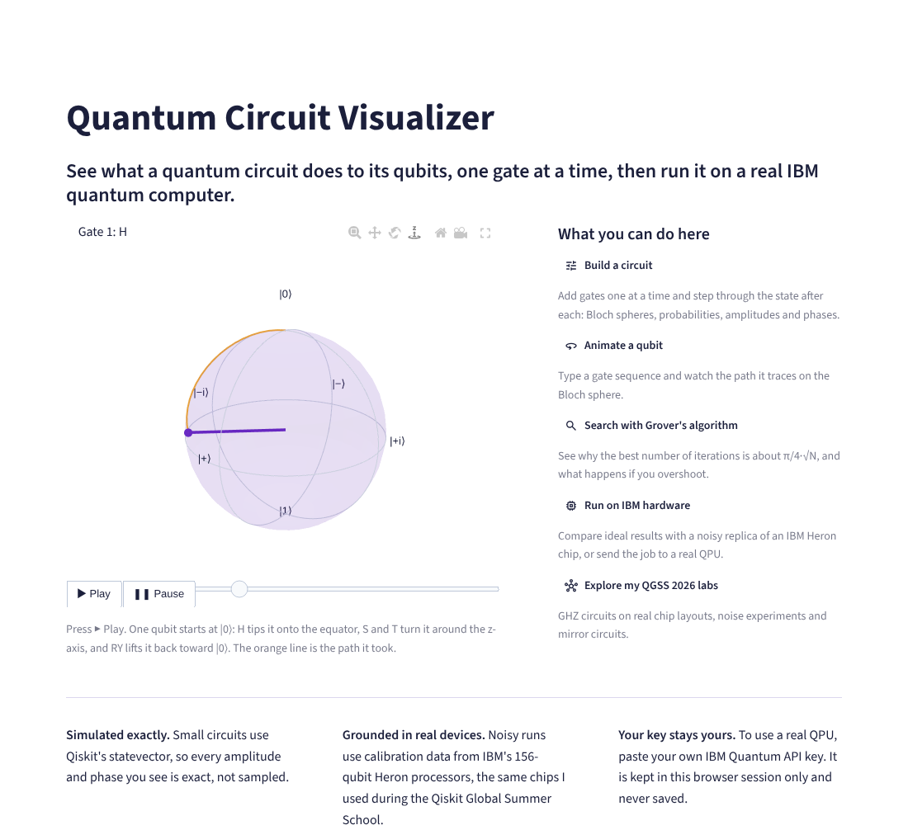
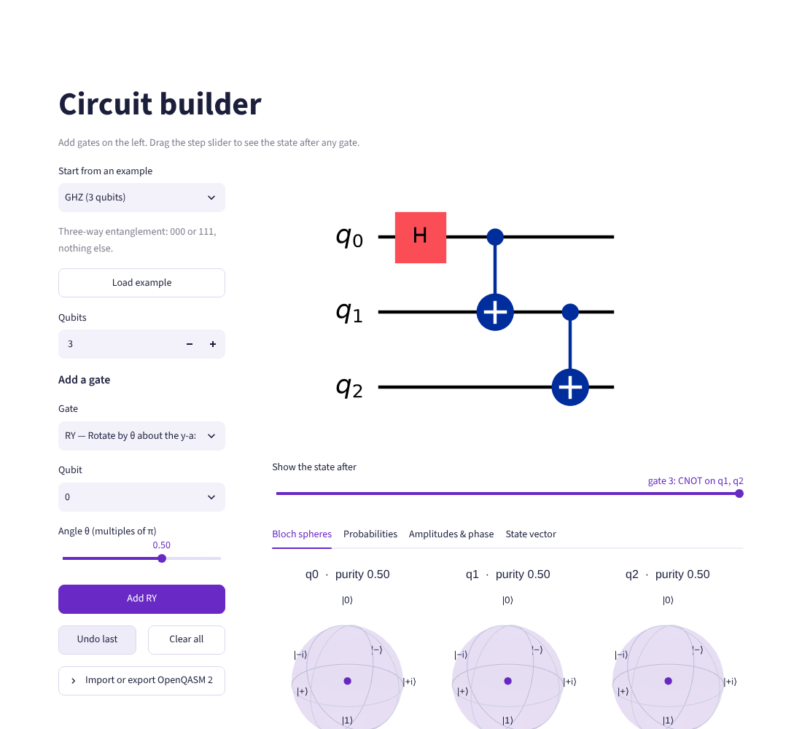
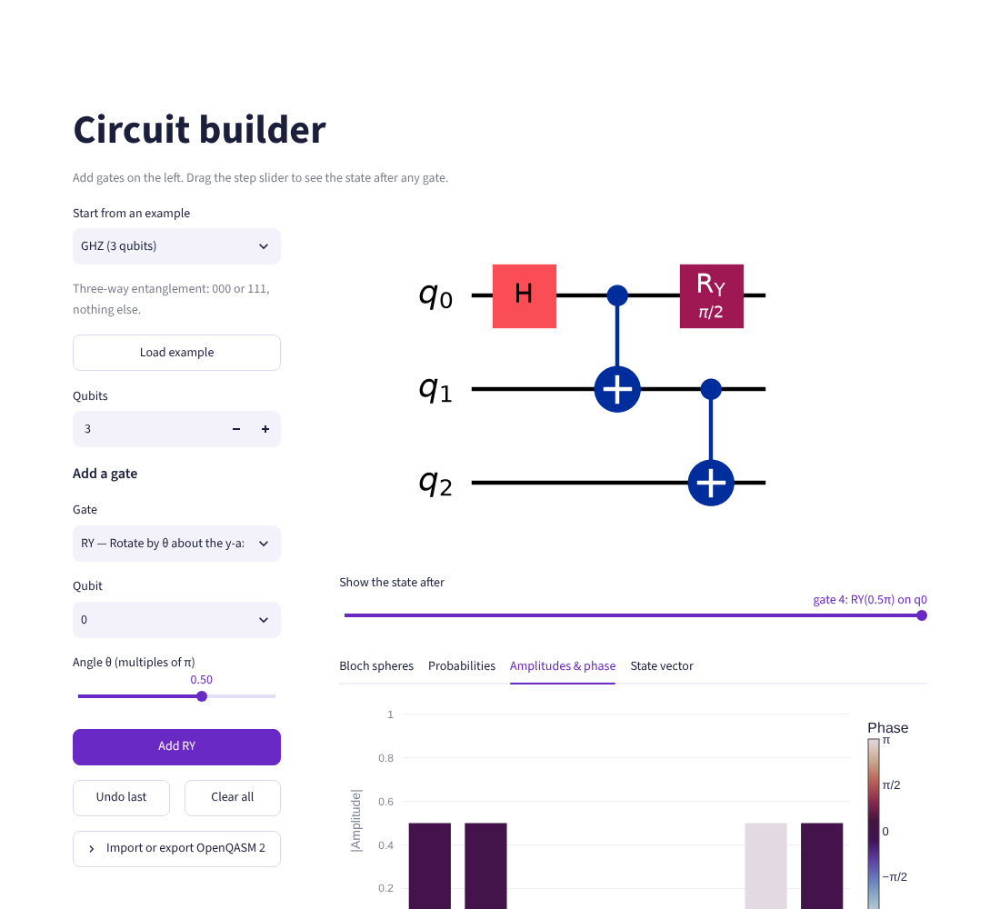
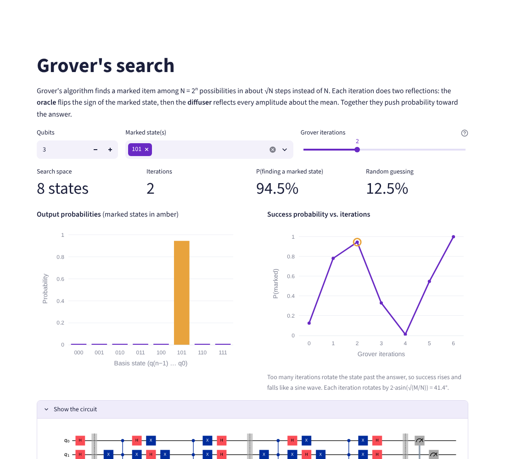
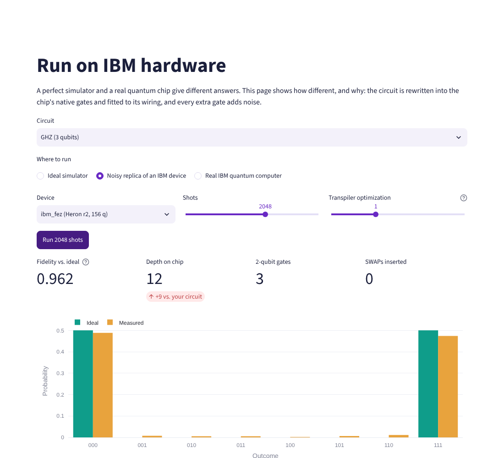

# Quantum Circuit Visualizer

**See what a quantum circuit does to its qubits, one gate at a time, then run it on a real IBM quantum computer.**

[**Live app → quantum-visualizer.streamlit.app**](https://quantum-circuit-visualizer-ex9xmkwectnaknfwrdvoh8.streamlit.app/)




I built this to make quantum circuits something you can *watch*. Most tools show a circuit diagram and a final histogram. This one shows the state after every gate: where each qubit sits on its Bloch sphere, how big each amplitude is, what its phase is, and what happens when the same circuit runs on a noisy 156-qubit IBM chip.

---

## Features

| | |
|---|---|
| **Circuit builder** | Add up to 16 gate types (H, X, Y, Z, S, T, √X, RX/RY/RZ, CNOT, CZ, SWAP, Toffoli) on up to 6 qubits. A step slider shows the exact state after any gate as Bloch spheres, probabilities, amplitudes coloured by phase, or the raw state vector. Circuits can be imported and exported as OpenQASM 2. |
| **Bloch sphere animator** | Type a sequence like `H S T RX(pi/2)` and watch the qubit trace its path. Each gate is decomposed into its rotation axis and angle. |
| **Grover's search** | Mark any states on 2–6 qubits and choose the number of iterations. The success-probability curve shows the √N speed-up and what happens when you overshoot. |
| **Run on IBM hardware** | Compare the ideal result with a noisy replica of a real IBM device (Fez, Marrakesh, Kingston, Torino, Brisbane), or submit to a real QPU with your own API key. It shows the transpiled circuit, extra depth, SWAPs and Hellinger fidelity. |
| **QGSS 2026 lab pages** | Interactive versions of my Qiskit Global Summer School work: GHZ circuits on real chip layouts, noise decay experiments and mirror-circuit benchmarking. |

<table>
<tr>
<td></td>
<td></td>
</tr>
<tr>
<td></td>
<td></td>
</tr>
</table>

---

## Things I learned building it

- **Entanglement makes Bloch vectors shrink.** After a CNOT creates a Bell state, each qubit's vector collapses to the centre of its sphere. On its own, an entangled qubit is a mixed state. The builder shows this through each qubit's *purity* (1.0 = pure, 0.5 = maximally entangled).
- **Every single-qubit gate is a rotation.** To animate gates smoothly I convert each 2×2 unitary into SU(2), read off its rotation axis and angle, and interpolate with Rodrigues' formula. The tests check that every animated path stays on the sphere and ends exactly where the gate sends the state.
- **Hardware adds depth.** A 3-qubit GHZ circuit has depth 3 on paper but about 12 on IBM Fez once it is rewritten into the chip's native RZ/SX/CZ gates. That extra depth is where the noise comes from. My [QGSS 2026 labs](https://github.com/sanjaayk/qgss-2026-quantum-labs) go further: growing a 64-qubit GHZ along a spanning tree of the chip cut depth from 256 to 47.
- **Library versions matter.** Qiskit 2.5 crashes a Streamlit app whenever a page reruns. I tracked it to the Qiskit version with a three-line test page, so this project pins `qiskit<2.5` ([details](docs/architecture.md#why-qiskit-is-pinned-below-25)).

---

## Run it locally

```bash
git clone https://github.com/sanjaayk/quantum-circuit-visualizer.git
cd quantum-circuit-visualizer
python -m venv .venv && source .venv/bin/activate   # Windows: .venv\Scripts\activate
pip install -r requirements.txt

streamlit run app/streamlit_app.py
pytest                                               # 60 tests
```

To run on a real QPU, create a free API key at [quantum.cloud.ibm.com](https://quantum.cloud.ibm.com) and paste it into the **Run on IBM hardware** page. The key is kept only in your browser session. Everything else works without an account.

## Project structure

```
quantum-circuit-visualizer/
├── app/
│   ├── streamlit_app.py      # entry point and navigation
│   ├── ui.py                 # shared drawing + IBM login helpers
│   └── views/                # one file per page
├── src/
│   ├── qviz/                 # visualizer engine (no Streamlit inside, fully tested)
│   │   ├── circuits.py       #   gate specs, presets, step-by-step states, QASM import/export
│   │   ├── bloch.py          #   Bloch vectors, purity, gate → rotation, animation paths
│   │   ├── algorithms.py     #   Grover oracle, diffuser, success curve
│   │   ├── hardware.py       #   ideal / noisy-replica / real-QPU runs, fidelity
│   │   └── plots.py          #   Plotly Bloch spheres, animations and charts
│   └── qlabs/                # circuits from my QGSS 2026 labs (GHZ, noise, Ising, mitigation)
├── tests/                    # pytest suite
├── docs/                     # architecture notes, deployment, screenshots
└── .github/workflows/        # CI: tests + "no API keys committed" check
```

The physics lives in `src/` and the interface lives in `app/`. Every number the app shows comes from a tested function, so the UI can change without breaking the maths. See [docs/architecture.md](docs/architecture.md).

## Related

- [qgss-2026-quantum-labs](https://github.com/sanjaayk/qgss-2026-quantum-labs): my graded Qiskit Global Summer School 2026 notebooks (QGSS 2026 Quantum Excellence badge, Advanced).

## License

MIT © 2026 Sanjaay Kumaraguru
